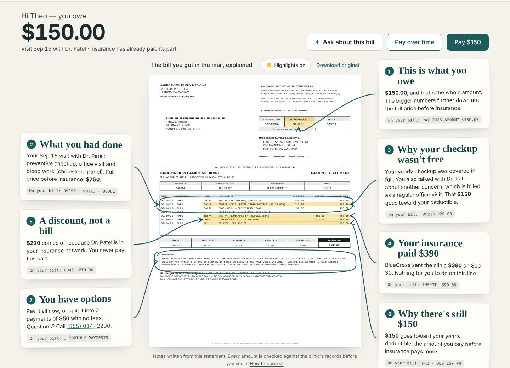
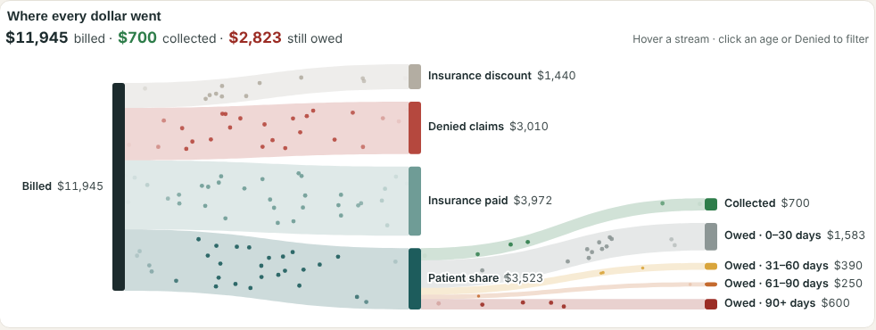

# Plainbill

**Patients get answers. Clinics get paid.**

Plainbill turns a confusing medical bill into one a patient can actually read, ask questions
about and pay. It's built for small, independent medical practices.



## The problem

When my mom gets a medical bill, I'm the one who explains it to her. The numbers don't add up at
a glance, the codes mean nothing, and English isn't her first language. Most patients are in the
same spot, just without someone to call.

When I talked it over with a primary care physician, another problem came up: surprise bills. A
patient comes in for a yearly checkup they expect to be free, mentions a new problem, and the
doctor deals with it. Insurance covers the checkup, but the new problem is billed as a separate
office visit and goes toward the deductible. The patient gets a bill they didn't see coming and
calls the front desk to ask why.

Small practices feel this too. Every confusing bill becomes a phone call, a late payment or a
balance that never gets paid.

## What Plainbill does

**For the patient**

- Shows the practice's own statement with the important lines highlighted and short notes in
  the margin: what you owe, what insurance paid, what was a discount, and why.
- Explains the "free checkup that wasn't" when it happens.
- Reads in English, Spanish, Haitian Creole, Chinese and more.
- Lets you ask questions ("Why do I owe $150?") and get answers about this bill only.
- Pay with PayPal, Pay Later or a card, or split it into 3 or 6 interest-free payments.

**For the front desk**

- Drop in insurance files (835 remittances, scanned EOBs) or self-pay visits. Plainbill works out
  what each patient owes and flags anything it isn't sure of.
- One grid of every balance, grouped by status, with a suggested next step for each one.
- Send a bill in one click: a PayPal invoice plus a short, friendly email with a link to the
  explained statement.
- Payments show up live on the dashboard.

**For the office manager**

- A "Where every dollar went" view: everything billed, flowing into discounts, denials,
  insurance payments, money collected and what's still owed.
- Ask questions in plain English ("Which payer denied the most?") and get a chart back.



## What we don't compromise on

- **Money is math, not AI.** Every dollar amount is calculated in code. The AI writes the words
  around the numbers, and anything it says is checked against them before anyone sees it.
- **The AI says when it isn't sure.** If a scanned form is hard to read, the uncertain field is
  flagged for a person to confirm.
- **Nothing is sent or charged without a person saying yes.** Staff approve every bill; patients
  confirm every payment.
- **Share as little as possible.** PayPal gets a name, visit date, provider and amount, nothing
  about the diagnosis or insurance.

## Built with

- **Claude** (Anthropic) reads scanned EOBs, writes the statement notes and messages, answers
  patient questions and powers the practice analyst.
- **PayPal** handles invoices, checkout, payment plans and payment notifications. More below.
- **AG Grid** for the front-desk dashboard and **AG Studio** for the practice insights.
- TypeScript throughout: React + Vite, Fastify, SQLite. Deploys to Render.

## Try it

You'll need Node 20.19+ (22 recommended) and pnpm 10.

```bash
pnpm install
cp .env.example .env   # add your keys; without them the AI runs offline and PayPal is off
pnpm seed              # load a fictional practice with 14 patients
pnpm dev
```

Open <http://localhost:5173/dashboard>. All data in this repo is made up.

Things to try:

- **Send a bill, then be the patient.** With PayPal sandbox keys set, open Theo Lambert on the
  dashboard and click **Send invoice**. Then open **Email ↗** in his row and follow the link.
  Verify as `Lambert`, born `04/11/1979`. Theo came in for a checkup, mentioned another problem,
  and owes $150. Switch to Español, ask the helper a question, then pay.
- **Set up a payment plan.** Do the same for Maria Delgado (`Delgado`, born `04/17/1984`) and
  pick 3 monthly payments.
- **Upload insurance files.** Run `pnpm seed --scenario=intake-demo`, go to **Intake** and click
  **Use the sample files**. Two hard-to-read fields get flagged.
- **Watch a payment land.** `pnpm simulate:payment "Samuel Ortiz"` marks a bill paid. The
  dashboard row flashes green and a coin drops into Collected on **Insights**.

To pay in the PayPal sandbox, use a sandbox buyer account or the test card `4012888888881881`
(any future expiry, any CVV). `pnpm seed` resets everything. `pnpm test` runs the test suite.

## How Plainbill uses PayPal

| Feature                       | What it's for                                                           |
| ----------------------------- | ----------------------------------------------------------------------- |
| Invoicing v2                  | The bill itself, with partial payments allowed (minimum $20)            |
| Orders v2 + JS SDK            | The pay button on the patient page: PayPal, Pay Later or a card         |
| Subscriptions v1              | 3- or 6-month interest-free payment plans                               |
| Webhooks + a background check | Marks bills paid; the check catches anything a webhook missed           |
| Agent Toolkit                 | Lets the patient's AI helper start a payment or plan after they confirm |

A few things we learned in the sandbox:

- An invoice with no recipient email still works. Sending it with PayPal's own emails turned off
  gives a link the patient can pay from, and we send our own email instead.
- When a patient pays on our page, we record that payment on the invoice too, so the invoice link
  can't collect the same money twice.
- Plans that don't divide evenly ($368 over 6 months) use a first payment of $61.35, then five of
  $61.33, so the total is exact.
- Capturing the same order twice returns an error we handle safely, and webhooks are verified
  with PayPal before we trust them.

## Settings

Copy `.env.example` to `.env`. Everything is optional; the app runs without keys.

| Setting                                    | What it does                                               |
| ------------------------------------------ | ---------------------------------------------------------- |
| `ANTHROPIC_API_KEY`, `ANTHROPIC_MODEL`     | Turns on Claude. Without it, recorded and template answers |
| `PAYPAL_CLIENT_ID`, `PAYPAL_CLIENT_SECRET` | PayPal sandbox app (`PAYPAL_ENV=sandbox`)                  |
| `PAYPAL_WEBHOOK_ID`                        | Needed to accept PayPal webhooks once deployed             |
| `VITE_AG_GRID_LICENSE_KEY`                 | AG Grid Enterprise and AG Studio (trial mode without it)   |
| `RESEND_API_KEY`, `EMAIL_TO_OVERRIDE`      | Real emails, optionally all sent to one test address       |
| `APP_BASE_URL`, `SESSION_SECRET`           | Public URL for pay links; key for patient sessions         |
| `INSIGHTS_PATIENT_NAMES`                   | Names the analyst sees: `full`, `initials` or `off`        |

`.env.example` lists the rest, with defaults.

## Deploy

`render.yaml` sets up one Render web service. In Render, choose **New → Blueprint**, pick this
repo and fill in the keys. After the first deploy, run
`pnpm paypal:webhook https://<your-service>.onrender.com` locally and add the
`PAYPAL_WEBHOOK_ID` it prints to Render.

## Privacy

This is a hackathon project and uses synthetic data only. Staff pages have no login yet, so don't
use it with real patients. Real use would need HIPAA safeguards and a Business Associate
Agreement with the AI and email providers.

## License

[MIT](LICENSE)
